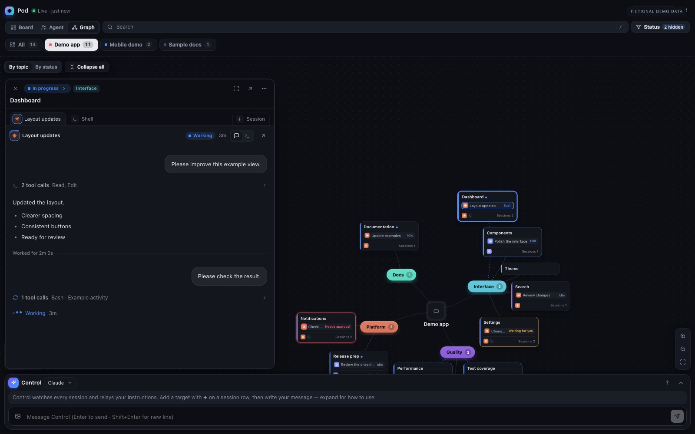
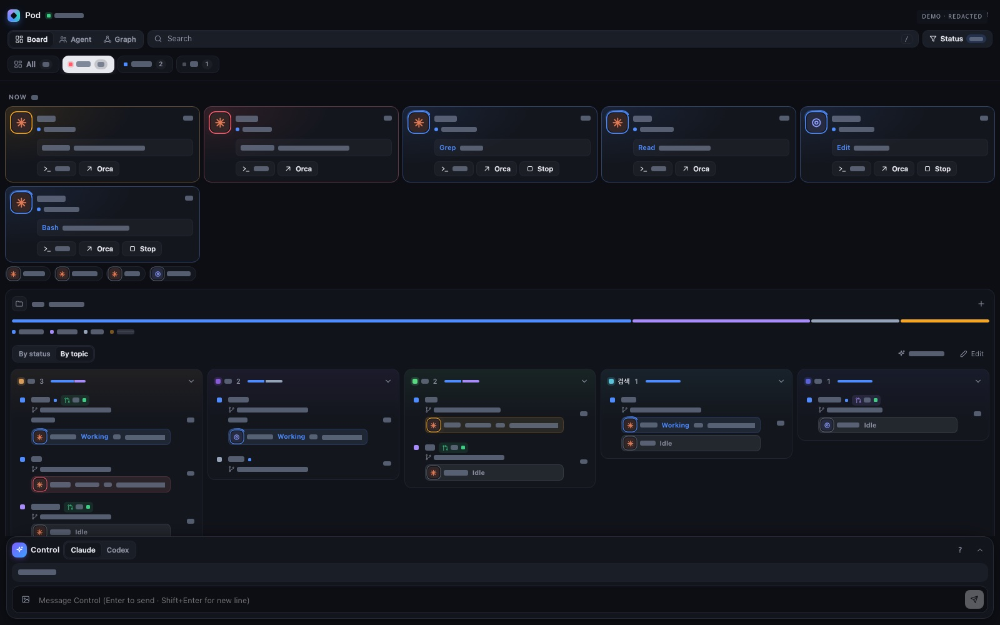

# Pod

**See and steer your Orca workspaces and agent sessions from one panel.**


Pod brings your repositories, topics, workspaces, and agent sessions onto one map. See what needs your attention, open a session without leaving the graph, and coordinate the next instruction through Control.

## What you can do

- **Explore the graph.** Group workspaces by topic or status, collapse groups, zoom, and drag cards between topics.
- **Find sessions that need you.** The board and agent views surface approval requests, unanswered questions, and active sessions.
- **Work inside the map.** Open a session window, read Claude conversations, and view terminal output. Control stays available while you read.
- **Coordinate with Control.** Ask for a status update or relay a message to a selected session. Use the ✦ button on a session row to add a compact target chip.
- **Keep things organized.** Create topics and subtopics, start sessions, edit workspace notes, and close leftover terminal tabs.

## A closer look

### Session window

Read a conversation without navigating away from the graph. Use Control to coordinate supported sessions, or open the session in Orca for direct interaction.



### Control

Use the bottom bar to check progress and coordinate sessions. Expand it to read the conversation. Press **Enter** to send and **Shift+Enter** for a new line.


### Board

See sessions that need attention first, followed by workspaces grouped by topic or status.



**Screenshot privacy:** every screenshot is generated from fictional demo data. Names and conversations are generic examples. Real workspace names, branches, pull request details, file paths, commands, and internal discussions are not included.

## Requirements

- Orca **1.4.248 or later** on macOS.
- The `orca` command available in your terminal.
- An installed and signed-in agent CLI for Control. Claude Code is required for AI topic suggestions.

## Install

Find Pod in Orca's plugin list, or load a local clone:

```sh
git clone https://github.com/Erlhon9/orca-pod
orca plugin dev load ./orca-pod
```

Review the permissions shown by Orca before approving the plugin. Keep a development folder in place while it is registered; removing it also removes the local plugin.

## Get started

1. Open **Pod** in the Orca sidebar.
2. Choose a repository and switch between **Graph**, **Board**, and **Agent** views.
3. Click a workspace or session to open its window.
4. Use the session's ✦ button to add a target chip to Control, then write what you want to send. Add multiple targets or remove individual chips with ×; selecting a target keeps your draft intact.

| Shortcut | Action |
| --- | --- |
| `/` | Search |
| `i` | Focus the Control input |
| `[` / `]` | Switch repositories |
| Enter | Send a Control message |
| Shift+Enter | Add a new line |

## Sessions and delivery

Claude terminal sessions can appear as conversations using their local transcripts. Codex sessions and other terminals use the terminal view when a conversation view is unavailable. Session windows in Pod are read-only. Open a session in Orca when you need its full native interface.

Control can relay instructions to supported agent terminal sessions. Claude-to-Claude chat messaging uses Claude Code messages. A message being accepted or queued does not mean the receiving agent has finished the task.

Shell terminals are not message targets for Control.

## Control agents and language

- **Choose a Control agent.** Select from the Orca agent catalog, with detected agents listed first. Claude and Codex have embedded adapters; other agents run in an Orca terminal using their existing installation, login, and permissions. Recent conversation context follows you when you switch.
- **English-first UI.** English is the default for new users. The visible Language button shows the active setting; Korean and an automatic language option remain available. Existing choices are preserved.

Terminal-based Control shows the agent’s terminal output in the panel and provides an Open in Orca button for login and approvals. An agent being detected does not prove it is logged in or has available usage. Codex Control currently reads chats' latest request and reply but cannot send messages to chat sessions. Claude and Codex Control can both send to supported terminal sessions. Switching agents carries recent visible conversation context without requiring a reply from the previous provider, so you can switch when its usage is exhausted.

## Permissions and data

Pod requests access to workspaces, agents, terminals, and its own storage so it can display session state and perform the actions you select. Sending an instruction can cause the receiving agent to act with that session's permissions.

AI features use your installed agent CLI and its account. Context passed to those features is processed by the selected provider. Topic suggestions include workspace metadata; Control uses session information to resolve the targets you request.

## Development

```sh
orca plugin dev watch . --check --shot ./.orca/shots --json
orca plugin test . --json
orca plugin validate . --json
```

Public screenshots are generated with `tools/public-screenshots.sh` in the development repository. The capture uses fictional fixtures and does not query live workspaces. Review the images before publishing; the publisher checks their recorded hashes.
