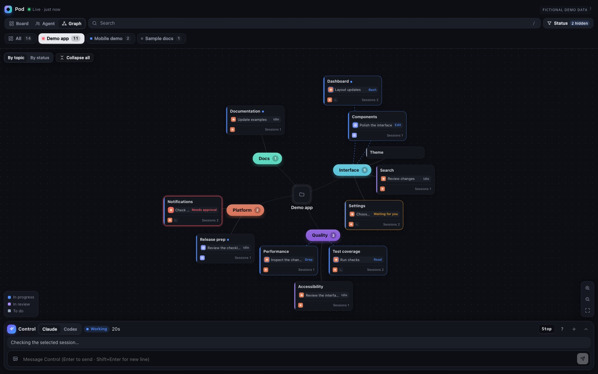
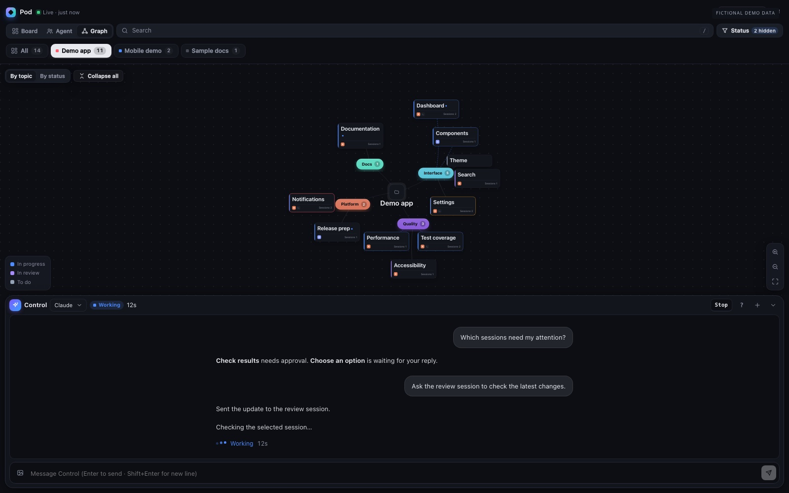

# Pod

**Understand, prioritize, and continue work across Orca sessions.**

Version **0.6.0** · [Release notes](CHANGELOG.md#060)



Pod brings your repositories, topics, workspaces, and agent sessions onto one map. See what needs your attention, open a session without leaving the graph, and coordinate the next instruction through Control.

## What you can do

- **See work in Dashboard.** Open Overview, Development, Work flow, Agent, Computer, or Activity. Select a current work item to prepare its existing Control target; selecting it does not call a model or send an instruction.
- **Review a month of activity.** Choose a month, repository or topic, PR author, and record kind. Inspect merged PRs, observed checks, decisions, and their sources. Totals cover the complete retrieved month; lists are paginated. Merges are read through your installed, authenticated GitHub CLI. Source errors and partial results remain visible.
- **Inspect the Pod host.** The Computer tab reads CPU, total/free memory, filesystem space, related processes, and supported battery data. It samples while visible and stops requesting on other views. These are host observations; they do not identify a particular agent as the cause of a slowdown.

- **Prioritize current work.** Use P0/P1/P2 badges on the map, board, and in Control. Click a badge to set a priority or return to Automatic, and filter by priority beside the scope bar. P0 is user-designated. Automatic P1 reflects explicit questions, blocked sessions, or failed PR checks without an active session; ordinary waiting stays P2. Control shows the reason. Overrides survive reopening and are bound to the workspace branch.
- **Look back by date.** Open Today’s history or choose a date above the map. Start with grouped workspaces, select one for its records and evidence, and choose Continue in current work to return to its latest available context. Historical browsing is read-only for work actions and preserves your current drafts. History starts with collection, retains gaps and historical names, and is independent of the provider conversation.
- **Find your next stop on the map.** Use Needs you to cycle through P0 and P1 work, with user-designated P0 first. Their groups open and the map moves to the selected card.
- **Select work, continue in Control.** Click a card or session to set Control's context. Keep drafts separately for each target, ask questions, or explicitly relay instructions. Open source conversations when you need them.
- **Prepare a briefing.** With Claude or Codex Control, choose Prepare briefing to read available session records without allowing session-send tools. The last completed briefing is saved separately from provider conversation history; changes since that briefing are marked. Chat-session tools expose recent excerpts, not complete history.
- **Let Control speak first.** Enable periodic briefings and/or important-change notices in Control menu → Briefing settings. Choose an interval from 1–240 minutes and monitor all projects or the current view. Brief me now gives an on-demand overview without writing a question. Automatic checks run while the panel is visible, defer while you compose or Control is busy, and skip unchanged input. Ordinary waiting is not treated as a question. Recent briefings are stored in Pod independently of provider history.
- **Browse by repo or topic.** Switch the top scope bar to Topic to find work across repositories, then choose a topic and subtopic. Matching uses the complete topic path, so equally named subtopics under different parents stay separate. Graph, Board, and Agent use the same filter; your previous repository choice is kept when you switch back.
- **Organize topics with Control.** Open Manage topics beside the repository/topic scope bar, then choose Suggest classification. The selected embedded Claude or Codex proposes topics, subtopics, and workspace assignments for the named repository. Review the tree, moves, and reasons before applying. Completed work keeps its classification, and a stale proposal requires a new analysis. Edit topics is available in the same menu.
- **Explore the graph.** Group workspaces by topic or status, collapse groups, and zoom. Automatic placement keeps topics, subtopics, and their work in separate tree branches. Drag cards and group labels into free space to keep your own arrangement, or drop a card onto a group label to move it between groups. Positions are remembered for each repository view and grouping mode; the always-visible Auto arrange button resets the current view's positions.
- **Find sessions that need you.** The board and agent views surface approval requests, unanswered questions, and active sessions. Read pending questions and choices in session windows and hover cards, then open the session in Orca to answer.
- **Work inside the map.** Open a session window, read Claude conversations, and view terminal output. Control stays available while you read.
- **Read in narrow panels.** Automatic map views keep cards at their normal text size and center on the selected card or the next item needing attention. Pan to explore, choose the fit icon for an overview, or use Read cards to return. Minimize Context to a title strip and expand it without losing your reading position.
- **Coordinate with Control.** Ask for a status update or relay a message to a selected session. Use the ✦ button on a session row to add a compact target chip.
- **Keep things organized.** Create topics and subtopics, start sessions, edit workspace notes, and close leftover terminal tabs.

## A closer look

### Session window

Read a conversation without navigating away from the graph. Use Control to coordinate supported sessions, or open the session in Orca for direct interaction.


### Control

Use the bottom bar to check progress and coordinate sessions. Expand it to read the conversation. Press **Enter** to send and **Shift+Enter** for a new line.

Choose **Bottom**, **Right**, **Left**, or **Auto** from the position button in the Control header. Bottom is the default. A fixed position stays in place across resizing, folding, view changes, and reopening; Auto uses the responsive layout. Full reading temporarily expands Control and returns to the selected position.

Start a new conversation from **Control menu (…) → New conversation**. It resets the provider conversation while retaining Pod's stored work memory and briefings. This action is unavailable while Control is replying.



### Board

See sessions that need attention first, followed by workspaces grouped by topic or status.


**Screenshot privacy:** screenshots show the earlier layout with fictional demo data; 0.5.0 added priority and dated-history controls; 0.6.0 adds Dashboard. Names and conversations are generic examples. Real workspace names, branches, pull request details, file paths, commands, and internal discussions are not included.

## Requirements

- Orca **1.4.248 or later** on macOS.
- The `orca` command available in your terminal.
- The GitHub CLI (`gh`), authenticated for the selected repositories, for merged-PR history.
- An installed and signed-in agent CLI for Control. Embedded Claude Control requires Claude Code **2.1.325 or later**, including its restricted mode. Topic organization also supports embedded Codex Control. Pod does not install or update agent CLIs.

## Install

Find Pod in Orca's plugin list, or load a local clone:

```sh
git clone https://github.com/Erlhon9/orca-pod
orca plugin dev load ./orca-pod
```

Review the permissions shown by Orca before approving the plugin. Keep a development folder in place while it is registered; removing it also removes the local plugin.

## Get started

1. Open **Pod** in the Orca sidebar and choose a repository or topic. Graph, Board, and Agent share the same scope and priority filter.
2. Select a workspace card or session to continue in **Control**. Selection alone does not call the model or send an instruction. Open the source explicitly when you need its full context.
3. Use **Brief me now** for an overview, or enable periodic/change briefings in **Control menu → Briefing settings**. Existing work notes remain available from the workspace menu.
4. Click a priority badge to set P0/P1/P2 or return to **Automatic**. Use the date controls for grouped work history and **Continue in current work** to return from an old record.
5. Ask Control a question or explicitly request an instruction to an exact supported terminal session. Use the session’s ✦ action to add a target chip; target-specific drafts are retained. Open native chats in Orca to send messages or handle approvals.

Manual notes, generated briefings, and observed history are stored separately in Pod. Recent replies are excerpts and agent claims remain distinguishable from observed results or user confirmations. A provider conversation reset does not erase Pod's records. History is not a complete decision log or exact replay; automatic semantic extraction and structured promises remain future work.

**Reviewed up to here** records the workspace information you inspected. Reviewing does not approve a request, answer a question, or mark work complete.

| Shortcut | Action |
| --- | --- |
| `/` | Search |
| `i` | Focus the Control input |
| `[` / `]` | Switch repositories or top-level topics in the active scope mode |
| Enter | Send a Control message |
| Shift+Enter | Add a new line |

## Sessions and delivery

Claude terminal sessions can appear as conversations using their local transcripts. Codex sessions and other terminals use the terminal view when a conversation view is unavailable. Session windows in Pod are read-only. Open a session in Orca when you need its full native interface.

Embedded Claude and Codex Control can relay instructions to supported agent terminal sessions. Chat sessions expose their latest request and reply for reading; open the chat in Orca to send a message. A message being accepted or queued does not mean the receiving agent has finished the task.

Shell terminals are not message targets for Control.

## Control agents and language

- **Choose a Control agent.** Select from the Orca agent catalog, with detected agents listed first. Claude and Codex have embedded adapters; other agents run in an Orca terminal using their existing installation, login, and permissions. Recent conversation context follows you when you switch.
- **Choose a session agent.** Use Choose another agent in an Add session menu, or the explicit workspace Context action. Detection does not establish sign-in or available usage.
- **English-first UI.** English is the default for new users. The visible Language button shows the active setting; Korean and an automatic language option remain available. Existing choices are preserved.

Terminal-based Control shows the agent’s terminal output in the panel and provides an Open in Orca button for login and approvals. These agents use their normal permissions; Pod's embedded tool restrictions do not apply to them. An agent being detected does not prove it is logged in or has available usage. Switching agents carries recent visible conversation context without requiring a reply from the previous provider, so you can switch when its usage is exhausted.

## Permissions and data

Pod requests access to workspaces, agents, terminals, and its own storage so it can display session state and perform the actions you select. Sending an instruction can cause the receiving agent to act with that session's permissions.

AI features use your installed agent CLI and its account. Context passed to those features is processed by the selected provider. Topic proposals include workspace metadata and bounded session excerpts; Control uses session information to resolve the targets you request.

Pod runs as an Orca trusted worker with your operating-system access. Embedded Claude and Codex expose only Pod's session-list, session-read, and terminal-send tools. Review the [security model and data flows](SECURITY.md) before enabling AI coordination.

## Development

```sh
npm ci --ignore-scripts
npm run types
npm run typecheck
npm run test:security
npm run test:ui
npm run build:check
orca plugin test . --json
orca plugin validate . --json
```

Type generation requires Orca. Full plugin tests use the Orca CLI test runner. CI runs the worker security tests, fictional DOM flow tests, and browser/worker builds without an Orca installation. DOM flow tests execute the bundled panel in a Node DOM model; they do not open a browser, capture a screen, or establish visual layout quality. Test transports never send to a live agent.

Public screenshots are generated with `tools/public-screenshots.sh` in the development repository. The capture uses fictional fixtures and does not query live workspaces. Review the images before publishing; the publisher checks their recorded hashes.
